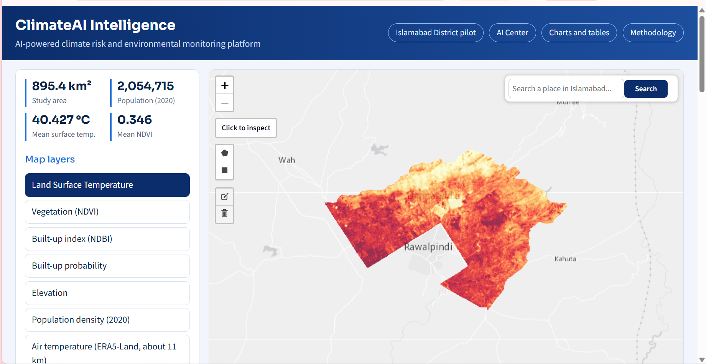
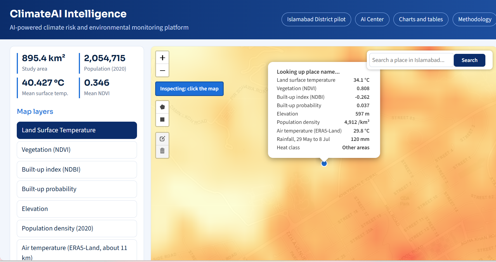
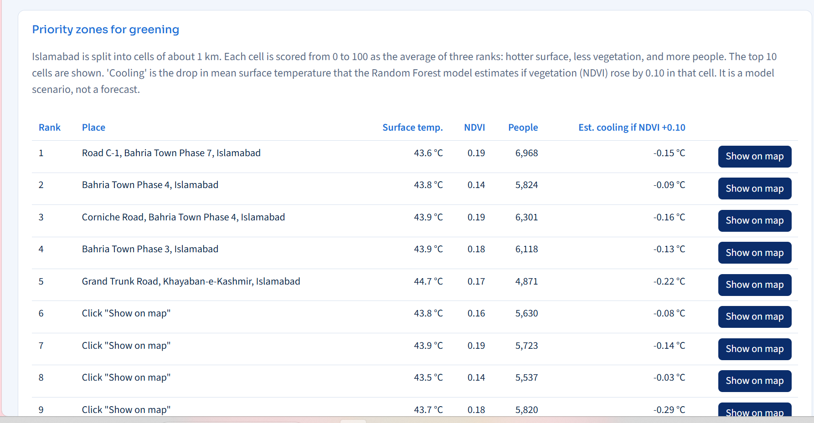
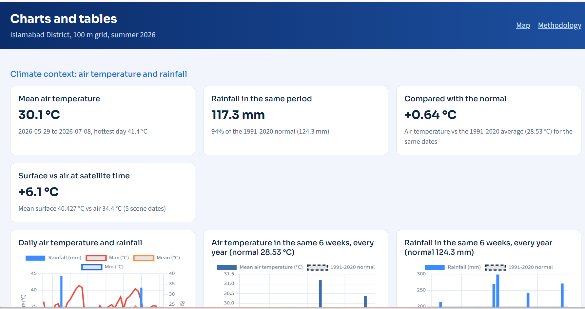
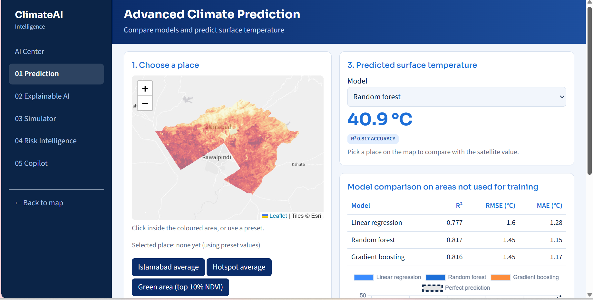
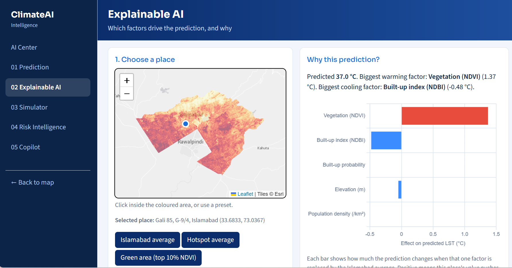
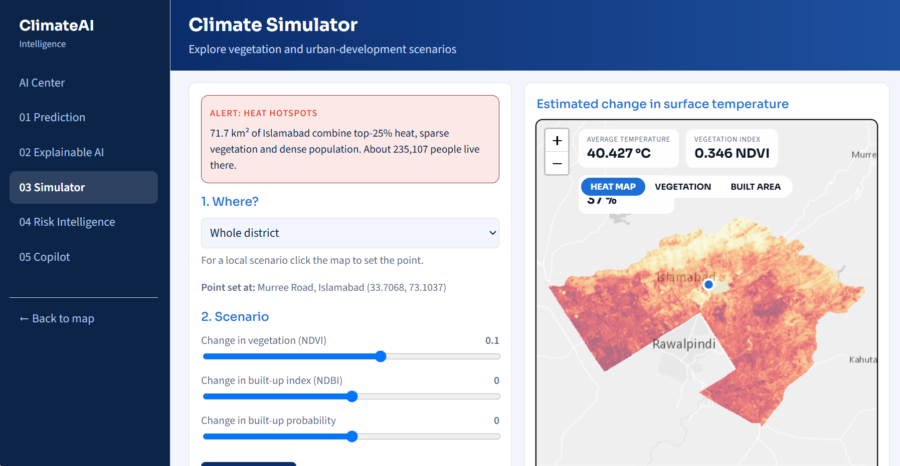
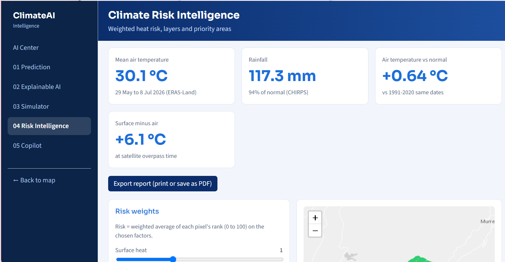
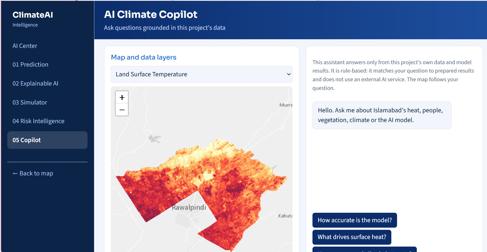

# ClimateAI Intelligence

### AI-Powered Climate Risk and Environmental Monitoring Platform
**Islamabad District pilot** | Built for the NYLP AI Hackathon 2026 | Solo project by Rameen Naeem

| | |
|---|---|
| **Live platform** | https://rameennaeemgeo.github.io/climateai-intelligence/ |
| **Source code** | https://github.com/rameennaeemgeo/climateai-intelligence |
| **Methodology page** | https://rameennaeemgeo.github.io/climateai-intelligence/methodology.html |
| **Demo video** | https://www.youtube.com/watch?v=RJo-xhhSDEU |

---

## 1. Overview
ClimateAI Intelligence is a public web portal that turns satellite and climate data into clear answers about urban heat in Islamabad District, Pakistan. It shows where the ground is hottest, which factors cause that heat, how many people live in the hottest places, what would happen if vegetation or built-up area changed, and where planting trees would help first. Everything on the site is computed from real data and real trained models. Where something is an estimate, a scenario or a rule-based answer, the page says so.

## 2. Problem
South Asian cities are warming fast. Planners who decide where to plant trees, build shade or regulate construction usually do not have a simple tool that shows, in one place, where surface heat, missing vegetation and dense population overlap. Satellite data that could answer these questions exists for free, but it is stored in technical formats that planners, students and residents cannot easily use. The result is that greening and cooling decisions are often made without evidence about which neighbourhoods need them most.

## 3. Users
- **City and district planners** who need to prioritise areas for trees, shade and cooling measures.
- **Researchers and students** who want a transparent example of heat analysis with real data and honest validation.
- **Residents and the public** who want to know how hot and green their area is compared with the rest of Islamabad.

## 4. Solution
The portal combines four things in one site:
1. **A map explorer** with nine layers and tools to click, search or draw an area and read its values.
2. **An analytics page** with statistics, histograms, relationships between indicators and a climate-context section.
3. **An AI Center** with five workspaces: prediction, explainable AI, a scenario simulator, a risk-intelligence map and a data-grounded assistant.
4. **A priority list** of the ten 1 km zones where greening would help the most people in the hottest, least green places.

The site is static (HTML, CSS and JavaScript), so it runs on GitHub Pages without a server. The heavy analysis is done offline in Python and Google Earth Engine, and the trained models are exported as small JSON files that run directly in the visitor's browser.

## 5. Features
- **Interactive map, 9 layers:** land surface temperature, vegetation (NDVI), built-up index (NDBI), built-up probability, elevation, population density, heat exposure class, air temperature and rainfall, with legends and an opacity slider.
- **Click to inspect and place search:** click anywhere, or search a place name, and the map zooms there and shows the place name, every layer value, the heat class and how the place compares with the Islamabad average.
- **Draw an area:** draw a polygon or rectangle to get average values, estimated population and the share of area in each heat class.
- **Priority zones for greening:** the ten highest-priority 1 km zones, each with surface temperature, vegetation, people affected and the cooling the model estimates if vegetation increased.
- **Charts and tables:** summary statistics, histograms, temperature-versus-indicator curves, a heat-class comparison, a correlation table, and a climate-context section.
- **AI Center (five workspaces):**
  1. **Advanced Climate Prediction:** compare three models on areas they never saw and predict surface temperature for any place or custom inputs.
  2. **Explainable AI:** see why a prediction was made, the overall importance of each factor and how each factor changes the prediction.
  3. **Climate Simulator:** add or remove vegetation or built-up area for the whole district or a circle around a point and see the estimated temperature change on a map, with matching strategies.
  4. **Climate Risk Intelligence:** a heat-risk map with weights set by the visitor, a layer switcher, risk-class statistics and the top priority areas.
  5. **AI Climate Copilot:** a rule-based assistant that answers questions from this project's own results and moves the map to match.
- **Place name and coordinates on the AI pages:** on the AI Center maps, click any point inside Islamabad and the page shows the name of that place (sector, neighbourhood, village or nearest named place, for example "Near Bhara Kahu (1.2 km NE)") together with its latitude and longitude. The coordinates appear straight away and the name follows a few seconds later. On the Prediction and Explainable AI pages the prediction and explanation belong to the selected place. On the Climate Simulator the page shows where the 1, 2 or 5 km circle is centred. On Risk Intelligence the Top 10 table has a Place column and the zoom popup shows the place name. If the click is outside the coloured study area, the page says "No data at this spot".
- **Methodology page:** data sources, definitions, models and limitations.

## 6. Study area
Islamabad District (about 895 km², FAO GAUL level 2 boundary), with a population of about 2.05 million (WorldPop 2020 estimate). Thresholds used for the heat classes were calculated across the larger Twin Cities region (Rawalpindi and Islamabad districts), so they describe Islamabad relative to the wider urban region.

## 7. Data
| Layer | Source | Period and resolution |
|---|---|---|
| Land surface temperature | Landsat 8 and 9 thermal data | 5 clear scenes: 29 May, 6 Jun, 14 Jun, 30 Jun, 8 Jul 2026; 30 m |
| NDVI and NDBI | Sentinel-2 | 8 dates, 29 May to 8 Jul 2026; 30 m grid |
| Built-up probability | Dynamic World | Averaged over 29 May to 8 Jul 2026 |
| Population density | WorldPop | 2020 estimate; 100 m |
| Elevation | SRTM (USGS and NASA) | 30 m, averaged to 100 m |
| Air temperature | ERA5-Land reanalysis (ECMWF) | Daily mean, 29 May to 8 Jul 2026; about 11 km |
| Rainfall | CHIRPS (UCSB Climate Hazards Center) | Daily, summed over the same dates; about 5 km |
| Boundary | FAO GAUL level 2 | Islamabad District |

All layers were processed in Google Earth Engine and Python, resampled to one common 100 m grid (UTM zone 43N) and clipped to Islamabad District. Air temperature and rainfall are much coarser than the other layers, so on the map they are smoothed onto the 100 m grid and look like gentle gradients. They add climate context, not 100 m detail.

## 8. Methodology, step by step

**Step 1: Define the study area.** The Islamabad District polygon from FAO GAUL level 2 was used to clip every layer. The same boundary file was reused in every script so that all layers cover exactly the same ground.

**Step 2: Land surface temperature.** Landsat 8 and 9 thermal bands were converted to temperature in degrees Celsius for five clear scenes in the May to July 2026 window. The scenes were combined into one composite so that a single cloudy or unusually warm day does not dominate the result. Land surface temperature is the temperature of ground and roofs seen from space, which is higher than the air temperature people feel.

**Step 3: Vegetation and built-up indices.** From Sentinel-2, NDVI (how green a pixel is) and NDBI (how built-up or bare it is) were computed on eight dates and combined into one composite. NDVI and NDBI are strongly related (correlation -0.91), because places with more vegetation usually have less built-up material.

**Step 4: Built-up probability.** The probability that a pixel is built-up came from Dynamic World and was averaged over the same period. It gives a second, independent view of urban development.

**Step 5: Population and elevation.** WorldPop 2020 population density was converted to people per square kilometre. SRTM elevation was averaged from 30 m to the 100 m grid. Total population in any area is density multiplied by pixel area (0.01 km² per 100 m pixel).

**Step 6: One common grid.** All layers were aligned to a single 100 m grid and clipped to Islamabad, producing a table of 89,090 valid pixels, each with temperature, NDVI, NDBI, built-up probability, elevation, population density and heat class. This table is the basis for every model and chart.

**Step 7: Heat exposure classes.** Each pixel is placed in one of three classes. *Hot* means land surface temperature at or above the 75th percentile. *Hotspot* means hot, with vegetation (NDVI) at or below the 25th percentile and population density at or above the 75th percentile. Everything else is *Other areas*. The thresholds are relative to the region and are not health standards.

**Step 8: Climate context.** Daily air temperature (ERA5-Land) and rainfall (CHIRPS) were averaged over the district for 29 May to 8 Jul 2026. The same six-week window was computed for every year from 1991 to 2026, the 1991 to 2020 average was used as the normal, and 2026 was compared with it. To compare surface and air temperature fairly, ERA5-Land air temperature at 06:00 UTC (about 11:00 local time, close to the Landsat pass) was compared with the surface temperature on the five scene dates.

**Step 9: Main prediction model.** A Random Forest regression (150 trees, maximum depth 14) predicts land surface temperature from NDVI, NDBI, built-up probability, elevation and population density. To keep the accuracy honest, the district was split into blocks of about 2 km and 25% of whole blocks were held out for testing, so the test pixels are far from any training pixel. On these unseen areas the model reaches **R² = 0.83** with an error of **1.39 °C**.

**Step 10: Explainability.** Overall importance was measured by permutation importance on the held-out blocks: built-up index 40%, vegetation 29%, elevation 26%, built-up probability 3% and population density 3%. For a single place, the "why this prediction" view replaces one factor at a time with the Islamabad average and shows how much the prediction changes. Partial-dependence curves show how the prediction moves as one factor varies while the others stay typical.

**Step 11: Browser models and the AI Center.** Three compact models (linear regression, a 30-tree Random Forest and a 60-tree gradient boosting model) were trained on the same training blocks, compared on the same held-out blocks and exported as JSON. The browser evaluates them directly, so predictions, explanations and scenarios run live without a server. Their current accuracy is shown on the Prediction page. They are smaller than the main model, so their accuracy can be slightly lower.

**Step 12: Scenario simulator.** The compact Random Forest is run twice for every affected pixel, once with today's values and once with the visitor's changes to vegetation, built-up index or built-up probability. The difference is the estimated change in surface temperature, drawn as a map and summarised as area, people affected and the share of area cooling by at least 0.5 °C. This is a model-based what-if and not a forecast. Because NDVI and NDBI are strongly linked in reality, changing only one is an idealised case.

**Step 13: Risk index.** For each pixel, the risk score is a weighted average of its percentile rank for surface heat, lack of vegetation, population density and built-up probability, with weights chosen by the visitor. Scores are grouped into five classes (very low to very high). The top risk areas are found by ranking 1 km cells (with at least 30 pixels) by their average risk.

**Step 14: Priority zones.** The district is divided into cells of about 1 km. Each cell is scored from 0 to 100 as the average of three ranks: hotter surface, less vegetation and more people. The top ten cells are listed. The estimated cooling for a cell is the drop the Random Forest predicts if NDVI rose by 0.10 there.

**Step 15: Copilot.** The assistant is rule-based. It recognises what a question is about (accuracy, drivers, people in hotspots, priority zones, climate, what-if, data sources, limitations) and replies using numbers read from this project's own results files. It does not use a language model or any external AI service, so it can only answer what the data covers.

**Step 16: Web engineering and deployment.** Results are exported as PNG map overlays, small JSON files and one compact binary file with the values for each 100 m pixel. The site is plain HTML, CSS and JavaScript with Leaflet for maps, Leaflet.draw for drawing and Chart.js for charts, and it is hosted on GitHub Pages. Place names and search come from OpenStreetMap services (Nominatim reverse geocoding): when a point is clicked on the map or on an AI page, its coordinates are used to find the place name that contains it, and the nearest named places with distance and direction are added when needed. Requests are limited to about one per second, so names in the Top 10 table fill in one by one. The data values themselves always come from the project's own layers, never from the name service.

## 9. Results
- **Heat is concentrated.** About 8% of the district (71.7 km²) is Hotspot, and roughly **235,000 people (11.4% of the population)** live there. Another 79.2 km² is Hot but not Hotspot, with about 124,000 people. The remaining 740 km² (83%) is Other areas, with about 1.70 million people.
- **Hotspots are hot and less green.** Mean surface temperature is about 44.5 °C in both Hot and Hotspot areas, compared with 39.7 °C elsewhere. Hotspots have the lowest mean NDVI (0.16, against 0.38 elsewhere) and the highest built-up probability (0.48).
- **Vegetation and built-up material explain most of the heat.** Surface temperature correlates -0.81 with NDVI and +0.82 with NDBI, and -0.65 with elevation. The Random Forest ranks built-up index (40%), vegetation (29%) and elevation (26%) as the strongest drivers. Elevation mostly reflects cooler higher ground and cannot be changed, which is why vegetation and built-up area are the planning levers.
- **The model generalises to unseen areas.** R² = 0.83 and RMSE = 1.39 °C on held-out 2 km blocks.
- **Greening has a measurable modelled effect.** Raising NDVI everywhere by 0.05, 0.10 and 0.15 lowers the modelled mean surface temperature from 40.45 °C to 40.29, 40.03 and 39.71 °C. Zone-level estimates are on the priority list.
- **Summer 2026 context.** Mean air temperature for 29 May to 8 Jul 2026 was 30.1 °C (hottest day 41.4 °C), about 0.64 °C above the 1991 to 2020 normal for the same dates. Rainfall was 117.3 mm, 94% of normal. The ground was about 6.1 °C hotter than the air at satellite time (40.4 °C against 34.4 °C). The 1991 to 2025 trend for this window is about +0.32 °C per decade, which is indicative only.

## 10. Conclusion
The project shows that free satellite and climate data can be turned into a practical, transparent decision aid for urban heat. In Islamabad District the hottest places are the ones with the most built-up material and the least vegetation, and a meaningful share of the population lives there. A Random Forest trained on only five indicators predicts surface temperature well on areas it has never seen, and its explanations match physical intuition: more vegetation cools, more built-up surface warms. Turning these results into a ranked list of priority zones and a scenario tool moves the analysis from "where is it hot" to "where should we act first, and what could we gain".

The platform is a screening tool and not an official risk assessment. It uses one summer season, the air-temperature and rainfall layers are coarse, population is a 2020 estimate and results have not yet been checked against ground measurements. These limits are shown on the site. The natural next steps are multi-year data for trends and forecasting, validation with weather-station and field data, finer air-temperature data, extension to other cities, and a secure backend for a language-model assistant.

## 11. How the project meets the hackathon criteria
- **Innovation:** a single portal that links data, validated models, explanations, scenarios and a ranked action list, with an assistant that is honest about being rule-based.
- **Feasibility:** it already works end to end on real data, runs on free hosting without a server and needs no API keys.
- **Impact:** it addresses urban heat, which affects health and energy use, and it quantifies the people affected and the possible cooling.
- **Presentation:** a methodology page, honest limitations, screenshots, a demo video and this documentation.

## 12. Screenshots
| | |
|---|---|
|  |  |
|  |  |
|  |  |
|  |  |
|  | |

## 13. Repository structure
```
index.html                 Map explorer (map page)
analytics.html             Charts, tables and climate context
methodology.html           Methodology, data sources and limitations
ai-center.html             AI Center hub
ai-predict.html            Advanced Climate Prediction
ai-explain.html            Explainable AI
ai-simulate.html           Climate Simulator
ai-risk.html               Climate Risk Intelligence
ai-copilot.html            AI Climate Copilot
app.js, draw.js, ai.js     Map, tools and AI Center logic
styles.css                 Styling
data/                      Layer images (data/layers) and JSON and binary results
ai/                        Python scripts used to prepare data and train models
docs/screenshots/          Images used in this README
```

## 14. Run it locally
1. Clone this repository.
2. In the repository folder run `python -m http.server 5500`.
3. Open `http://localhost:5500/` in a browser. No API keys are needed.

## 15. Reproduce the data pipeline
The scripts in `ai/` were run in this order after the satellite layers were prepared. They need the processed rasters (not included because of their size) and a Google Earth Engine account.

| Script | What it produces |
|---|---|
| `22_web_export.py` | Map overlays, `stats.json` and the table of 89,090 pixels |
| `23_train_model.py` | The main Random Forest, accuracy, importance and what-if results |
| `24_charts_data.py` | Statistics, histograms and correlations for the Charts page |
| `25_pixel_export.py` | `pixels.bin`, the compact per-pixel values used by the click and AI tools |
| `26_priority_zones.py` | The top 10 priority zones |
| `27_climate_layers.py` | Air temperature and rainfall map layers |
| `28_climate_context.py` | Daily series, 1991 to 2026 comparison and surface-versus-air results |
| `29_ai_models.py` | The three browser models, comparison, importance and curves |

## 16. Originality, AI use and credits
- **Originality:** the satellite layers were prepared earlier by the author in her own UrbanSense: Twin Cities project. The web portal, models, analytics, click, draw and search tools, climate context, AI Center and priority-zone engine were built for this hackathon.
- **AI tools used as development assistants:** Claude and ChatGPT helped with code and explanations. The author tested and reviewed all outputs.
- **Third-party AI services on the live site:** none.
- **Data:** Landsat (USGS and NASA), Sentinel-2 (ESA Copernicus), Dynamic World (Google and WRI), WorldPop (University of Southampton), SRTM (USGS and NASA), ERA5-Land (ECMWF and the Copernicus Climate Change Service), CHIRPS (UCSB Climate Hazards Center), FAO GAUL, Google Earth Engine. Data licences remain with their providers.
- **Software:** Leaflet, Leaflet.draw, Chart.js, Python, scikit-learn, pandas, NumPy, rasterio and matplotlib. Basemap tiles by Esri. Place names: © OpenStreetMap contributors (Nominatim).

## 17. Responsible use and privacy
The portal does not collect or store personal data. It has no accounts, tracking or API keys. When a visitor clicks or searches a place, the coordinates or search text are sent to OpenStreetMap services only to look up the place name. Results are a screening aid for planning discussions, not an official risk assessment, and should be combined with local knowledge and ground checks.

## 18. Known limitations
- One summer season only (29 May to 8 Jul 2026). The satellite data cannot show trends or forecast the future.
- Land surface temperature is not air temperature. Air temperature and rainfall are coarse (about 11 km and 5 km) and smoothed on the map.
- Population is a modelled 2020 estimate.
- NDVI and NDBI are strongly related, so their importance shares should not be read as separate causes. The models find associations, not proof of cause.
- Results have not yet been validated against ground measurements.
- The models were trained and tested in Islamabad District only and should be retrained before use elsewhere.
- Place names (map page and AI pages) and search depend on OpenStreetMap coverage and need an internet connection. In rural areas the name may be a nearby village or road instead of a sector, and if the name service cannot be reached the page shows the coordinates and "Name unavailable".
- The Copilot is rule-based and can only answer what this project's data covers.

## 19. Team
**Rameen Naeem** (solo): research, data preparation, AI modelling, web development, documentation and presentation. GitHub: [@rameennaeemgeo](https://github.com/rameennaeemgeo)
